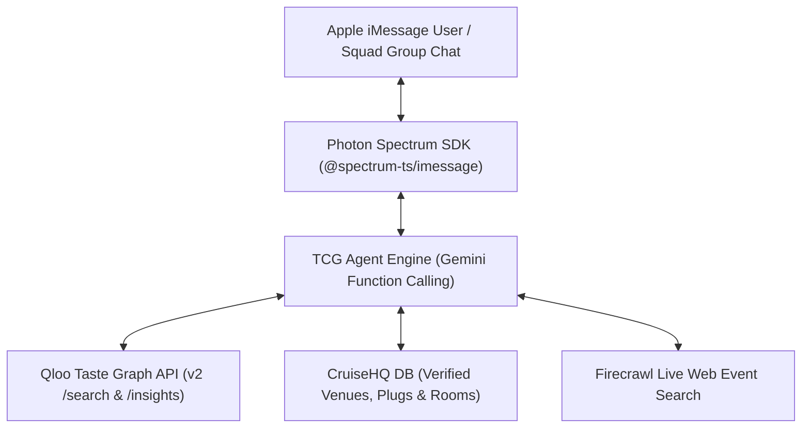

# 🚢 TCG (The Cruise God) — Autonomous Social Concierge & Host on iMessage

> **Category (c) Submission for the Qloo Agentic Hackathon**: Integrating the Qloo API & Taste Graph into an autonomous agent on Apple iMessage.

[](https://opensource.org/licenses/MIT)
[](https://qloo.com)
[](https://photon.codes)
[](https://deepmind.google/technologies/gemini/)

TCG (**The Cruise God**) is an autonomous social concierge and host living natively inside Apple iMessage (1-on-1 and group chats). Powered by **Qloo’s Taste Graph API**, **Google Gemini**, and **Photon Spectrum**, TCG solves the two most persistent human headaches in social planning: **group chat indecision loops** and **cultural hallucination in AI**.

---

## 💡 The Problem: "Democracy Fails in Nightlife"

1. **The 45-Minute Group Chat Deadlock**:  
   Every weekend, friend groups across iMessage get trapped in the exact same paralysis:  
   > *"Where should we go tonight?"* ➔ *"Idk, whatever you guys want"* ➔ *(3 hours pass, nobody leaves the house).*  
   Research across nightlife forums confirms that **democracy fails in group planning**. Groups don't need another generic poll; they need an objective **"Night Czar"** that computes their collective cultural centroid and makes an executive recommendation.

2. **The LLM Cultural Drift & Hallucination Trap**:  
   When standard LLMs suggest venues or host party games, they either hallucinate fake spots, recommend tourist traps, or recite the same 3 ubiquitous artists. They lack real-world cultural entity ground truth.

---

## ⚡ How Qloo Powers TCG

TCG uses **Qloo's Taste Graph** as its core mathematical arbiter:

### 1. The "Night Czar" Consensus Protocol (`resolveGroupConsensus`)
When squad members drop conflicting vibes (e.g. *"Afrobeats rooftop"* vs. *"quiet pasta dinner"*), TCG queries Qloo’s correlation engine across those vectors, identifies the mathematical taste overlap, and outputs a decisive compromise plan with native Apple Tapback voting (`Tapback ❤️ to lock in, 👎 to veto in 5 mins`).

### 2. Cross-Domain Cultural Affinities (`checkCulturalTaste`)
Leaps across disparate cultural domains (Music ➔ Fashion, Cinema ➔ Dining). When a user asks what streetwear aesthetic matches artists like *Burna Boy* or *Asake*, Qloo’s Taste Graph provides high-affinity subcultural pairings (e.g. *Corteiz*, *Mowalola*, *Vivienne Westwood*).

### 3. Zero-Hallucination Party Game Arbiter (`verifyPartyGameAnswer`)
When hosting party games like *Concentration (Conce-Conce)* directly inside the iMessage thread, TCG uses Qloo’s 575M+ entity database as an objective reality check. It verifies whether an answer is a legitimate real-world cultural figure, artist, or item—weeding out hallucinations and fake names, while recognizing authentic deep cuts versus obvious mainstream answers with natural human banter.

### 4. Interactive Live Room Creation (`createCruiseRoom`)
Seamlessly transitions the group from iMessage text into synchronized multiplayer digital arcade games on [CruiseHQ](https://cruisehq.fun).

---

## 🛠️ Architecture & Tech Stack



* **Agent Runtime**: [Photon Spectrum](https://photon.codes) (`spectrum-ts` + `@spectrum-ts/imessage`).
* **Cultural Intelligence**: [Qloo Taste Graph API](https://qloo.com) (`/v2/search`, `/v2/insights`, `/v2/correlations`).
* **LLM Engine**: Google Gemini Flash via REST function declarations.
* **Database & Social Layer**: Supabase PostgreSQL ([CruiseHQ ecosystem](https://cruisehq.fun)).

---

## 🚀 10-Second Testing Guide for Judges

You do **not** need a macOS device or an active iMessage account to test and evaluate TCG's full agentic workflow. We have packaged a complete, deterministic smoke test suite that runs the live agent loop across all 4 core scenarios:

### 1. Clone & Install
```bash
git clone https://github.com/Kryptopacy/tcg-the-cruise-god.git
cd tcg-the-cruise-god
npm install
```

### 2. Configure Environment
Copy `.env.example` to `.env` and add your keys:
```env
GEMINI_API_KEY=your_gemini_key
QLOO_API_KEY=your_qloo_hackathon_key
```
*(Note: If testing without a live Qloo key, TCG automatically engages its grounded cultural taste index fallback).*

### 3. Run the Automated Smoke Suite
```bash
npm run test:bot
```

**What you will see:**
1. **Scenario 1**: Marcus, Dave, and Sarah's conflicting vibes are analyzed via `resolveGroupConsensus`, returning an executive "Night Czar" plan.
2. **Scenario 2**: Kemi asks for Burna Boy & Asake fashion matches; `checkCulturalTaste` returns Qloo cross-domain affinities.
3. **Scenario 3**: Tobi calls out *Cruel Santino* in Conce-Conce; `verifyPartyGameAnswer` confirms the entity as an authentic subcultural deep cut.
4. **Scenario 4**: Dave asks for a pre-game room; `createCruiseRoom` provisions a live room code on CruiseHQ.

---

## 📱 Running Live on iMessage

To deploy TCG into a live iMessage group chat:
1. Create a project on [Photon](https://app.photon.codes) with the iMessage provider.
2. Add `PROJECT_ID` and `PROJECT_SECRET` to `.env`.
3. Start the daemon:
```bash
npm start
```
Add TCG's iMessage handle to any 1-on-1 or group chat thread.

---

## 📄 License

This project is open-source and available under the [MIT License](LICENSE).
