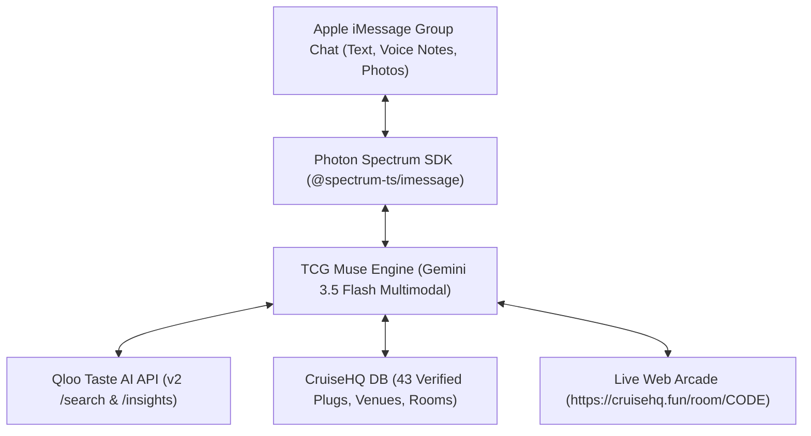

# 🚢 TCG (The Cruise God) — Autonomous Social Concierge & Host on iMessage

> **Built for Photon's "Make Your Own Muse" Hackathon & Powered by Qloo's Taste AI™ API**  
> *A charismatic, culturally tapped-in autonomous social agent living natively in Apple iMessage group chats.*

[](https://opensource.org/licenses/MIT)
[-black)](https://photon.codes)
[](https://qloo.com)
[](https://deepmind.google/technologies/gemini/)
[](https://cruisehq.fun)

---

## 🌟 Overview

**TCG (The Cruise God)** is an autonomous social concierge, cultural taste-maker, and game host living natively inside Apple iMessage (1-on-1 and multi-party squad group chats). Built on **Photon Spectrum**, **Google Gemini**, and **Qloo’s Taste Graph API**, TCG solves the most universal headache in group coordination: **group chat indecision loops, cultural disconnects, and friction in bringing friends together in the real world.**

TCG does not act like a generic assistant. It is a charismatic, culturally grounded crew member that listens to squad **voice notes**, reads **restaurant receipt photos**, resolves **40-minute group chat arguments** with executive consensus plans, books real **verified creative plugs**, referees in-chat party games (**Conce-Conce**), and spins up synced web arcade rooms on [CruiseHQ](https://cruisehq.fun).

---

## 🎯 Competing for Photon's "Make Your Own Muse" Categories

| Category | Why TCG Wins |
| :--- | :--- |
| ⏱️ **The Most Time-Saving Muse** | Eliminates the brutal 45-minute *"Where are we going? Idk, whatever you want"* loop in 10 seconds. Snaps bills and calculates per-person splits instantly. Slices hours spent DMing flaky DJs and promoters by pulling verified plugs directly from CruiseHQ. |
| ⚡ **The Most Unhinged Muse** | The unapologetic Squad Arbiter who ruthlessly suspends democracy when friends hesitate. Doesn't ask for a 10th poll—makes the executive call, drops a 5-minute Apple Tapback veto ultimatum, and roasts repeats during live games of Conce-Conce. |
| ✨ **The Most Inspiring Muse** | Uses AI to get people **off their phones and together in real life**. Deep taste graph mapping connects subcultures, music, and fashion to real local spaces, bridging digital chat into live shared memories. |

---

## 🚀 Core Superpowers

### 1. 🏛️ The 24/7 Squad Arbiter & Decision Engine (Group Chat Consensus)
In iMessage group chats, democracy fails. Whether it's picking a morning co-working cafe, deciding between an afternoon beach house or a daytime park picnic, or debating rooftop drinks vs. an underground set at midnight:
* Detects opposing squad desires across multiple senders (`[Sender: Marcus]`, `[Sender: Sarah]`).
* Computes their cultural taste overlap via **Qloo’s correlation engine** across any city (Lagos, London, Accra, New York, etc.).
* Decrees an executive compromise (brunch/dinner at Spot A, daytime wave or late set at Spot B) and triggers native **Apple Tapback voting** (`Tapback ❤️ to lock in, 👎 to veto in 5 mins`).

### 2. 🎙️ Native Multimodal Sensing (Voice Notes & Photos)
TCG isn't restricted to text:
* **Voice Notes:** Squad members can hold the mic in iMessage and speak naturally. Spectrum streams the audio bytes, and Gemini 3.5 ingests the voice note directly, parsing accents, energy, and intent.
* **Receipts & Menus:** Drop a photo of a bar tab, dinner receipt, or event flyer into the chat. TCG reads line items, spots service charges, and executes `splitCheck` on demand.
* **Outfit Checks & Flyers:** Analyzes party outfits and venue flyers against current street culture.

### 3. 🎯 Zero-Hallucination Verified Plugs & Venues (CruiseHQ Directory)
Unlike standard LLMs that invent fake street addresses or recommend generic tourist traps:
* TCG queries **CruiseHQ's live Supabase directory** of **43 real, verified creative plugs** (underground DJs, mobile mixologists, custom streetwear designers, photographers, videographers, barbers).
* Honest Fallback Doctrine: If no verified venues or events match in the local database, TCG states it honestly rather than hallucinating.

### 4. 🧬 Qloo Cultural Taste Graph Intelligence
Cross-domain subcultural matching powered by the official **Qloo Taste AI™ API**:
* Connects music preferences to fashion, dining, and nightlife (e.g. mapping fans of *Burna Boy* and *Asake* to authentic streetwear aesthetics like *Wekafore*, *Orange Culture*, and high-low vintage tailoring).
* Grounds recommendations in real entity graph intelligence rather than generic LLM stereotypes.

### 5. 🕹️ Game Master & Synced Multiplayer Web Rooms
* **In-Chat Party Games (Conce-Conce / Concentration):** Leads fast-paced rhythm clapping games in the group chat, tracking turns across friends and validating answers in real time against Qloo's 575M+ entity database.
* **CruiseHQ Synchronized Rooms (`createCruiseRoom`):** Seamlessly transitions the squad from iMessage text into live web arcade duels at `https://cruisehq.fun/room/{CODE}`, where everyone joins from their mobile screens with synchronized state.

### 6. 💸 Logistics & Bill Splitting
Native math engine calculates per-person breakdown with customizable tip percentages and tax division.

---

## 🏗️ Architecture



* **Runtime**: [Photon Spectrum](https://photon.codes) (`spectrum-ts` + `@spectrum-ts/imessage`) with auto-reconnect resilience.
* **LLM Engine**: Google Gemini 3.5 Flash (native multimodal audio & image processing).
* **Taste AI**: Qloo Taste Graph API (`https://hackathon.api.qloo.com`).
* **Database & Social Layer**: CruiseHQ Supabase PostgREST.
* **Cloud Ready**: Built-in HTTP health check server for 100% free deployment on Render, Koyeb, or Docker.

---

## ⚡ Quickstart & Testing

### 1. Clone & Install
```bash
git clone https://github.com/Kryptopacy/tcg-the-cruise-god.git
cd tcg-the-cruise-god
npm install
```

### 2. Configure Environment
Copy `.env.example` to `.env` with your keys:
```env
PROJECT_ID=your_photon_project_id
PROJECT_SECRET=your_photon_project_secret
GEMINI_API_KEY=your_gemini_api_key
GEMINI_MODEL=gemini-3.5-flash-lite
QLOO_API_KEY=your_qloo_api_key
SUPABASE_URL=https://vwxhxygaijvdthahjwec.supabase.co
SUPABASE_SERVICE_ROLE_KEY=your_supabase_key
```

### 3. Run the Automated Smoke Suite
```bash
npm run test:bot
```
Executes automated group chat simulations proving:
1. **Group Chat Arbitration ("Night Czar")** via Qloo correlation.
2. **Cross-Domain Taste Mapping** via Qloo `/v2/insights`.
3. **Conce-Conce Entity Verification** via Qloo entity validation.
4. **Live CruiseHQ Multiplayer Room Creation** with instant join URL.

### 4. Start Live iMessage Daemon
```bash
npm start
```
Starts TCG listening continuously on iMessage with auto-reconnect and health-check monitoring on port `3000`.

---

## 👥 Authors & Attribution

Built with passion for the **Photon "Make Your Own Muse" Hackathon** & **Qloo Agentic Hackathon**.  
Powered by [Photon](https://photon.codes), [Qloo](https://qloo.com), [Google Gemini](https://deepmind.google/technologies/gemini/), and [CruiseHQ](https://cruisehq.fun).
