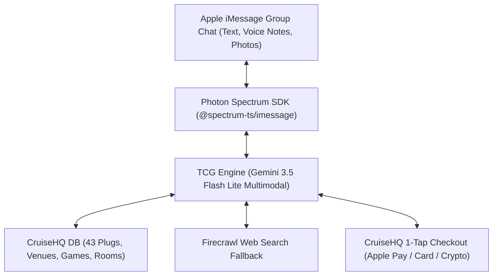

# 🚢 TCG (The Cruise God) — Autonomous Social Concierge & Squad Host on iMessage

> **Built for Photon's "Make Your Own Muse" Hackathon**  
> **Target Category:** ⚡ **The Most Unhinged Muse**  
> *A charismatic, culturally tapped-in autonomous social agent living natively in Apple iMessage group chats.*

[](https://opensource.org/licenses/MIT)
[-black)](https://photon.codes)
[](https://deepmind.google/technologies/gemini/)
[](https://cruisehq.fun)

---

## 🌟 Overview

**TCG (The Cruise God)** is an autonomous social concierge, squad arbiter, and game host living natively inside Apple iMessage (1-on-1 and multi-party squad group chats). Built on **Photon Spectrum**, **Google Gemini**, and **CruiseHQ**, TCG solves the most universal headache in group coordination: **group chat indecision loops, fragmented plans, and friction in bringing friends together in the real world.**

TCG does not act like a generic assistant. It is a charismatic, culturally grounded crew member that listens to squad **voice notes**, reads **restaurant receipt photos**, resolves **40-minute group chat arguments** with executive consensus plans, books real **verified creative plugs**, refereeing in-chat party games (**Conce-Conce**), and spinning up synced web arcade rooms on [CruiseHQ](https://cruisehq.fun).

---

## 🎯 Competing for Photon's "Make Your Own Muse" Categories

| Category | Why TCG Wins |
| :--- | :--- |
| ⏱️ **The Most Time-Saving Muse** | Eliminates the brutal 45-minute *"Where are we going? Idk, whatever you want"* loop in 10 seconds. Calculates instant 1-tap ticket checkout links via Apple Pay/Card. Slices hours spent DMing flaky DJs and promoters by pulling verified rate cards and booking links directly from CruiseHQ. |
| ⚡ **The Most Unhinged Muse** | The unapologetic Squad Arbiter who ruthlessly suspends democracy when friends hesitate. Doesn't ask for a 10th poll—makes the executive call, drops a 5-minute Apple Tapback veto ultimatum, and roasts repeats during live in-chat games of Conce-Conce. |
| ✨ **The Most Inspiring Muse** | Uses AI to get people **off their phones and together in real life**. Connects cultural subcultures and music tastes to real local spaces, bridging digital chat into live shared memories. |

---

## 🚀 Core Superpowers & Tools

### 1. 🏛️ The 24/7 Squad Arbiter & Decision Engine (`resolveGroupConsensus`, `promptGroupVote`)
In iMessage group chats, democracy fails. Whether it's picking a morning coffee run, deciding between an afternoon beach house or a daytime park picnic, or debating rooftop drinks vs. an underground rave:
* Detects opposing squad desires across multiple senders (`[Sender: Marcus]`, `[Sender: Sarah]`).
* Arbitrates conflicting vibes into an executive compromise route.
* Triggers native **Apple Tapback voting ballots** (`❤️ to lock in, 😆 for alternative, 👎 to veto in 5 mins`).

### 2. 🎟️ 1-Tap Event Tickets & Checkout (`getTicketCheckout`, `searchEvents`)
* Pulls live events and community popups across cities.
* When squad says *"Get me 2 VIP tickets to Obi's House"*, TCG calculates the exact tier breakdown and drops the **direct 1-tap checkout link** (`https://cruisehq.fun/events/...`) supporting Apple Pay, Card, and Crypto rails.

### 3. 🔌 Verified Creative Plugs & Instant Booking (`searchPlugs`, `bookPlug`)
* Directly queries CruiseHQ's directory of **43 real, verified creative plugs** (DJs, mobile mixologists, streetwear designers, photographers, private chefs).
* When the squad wants to book talent (*"Book DJ Ralph for 4 hours Saturday"*), TCG retrieves their verified rate card (`₦150k–₦200k`), generates a unique booking reference, and provides the direct deposit/checkout link.

### 4. 🍽️ Table & Lounge Reservations (`searchLocations`, `reserveVenue`)
* Searches verified venues, rooftops, and lounges with honest addresses and hours.
* Packages table reservation requests with party size, date, and direct reservation routing.

### 5. 🎙️ Native Multimodal Sensing (Voice Notes & Photos)
* **Voice Notes:** Squad members hold the mic in iMessage and speak. Spectrum streams the audio bytes, and Gemini ingests the voice note directly, parsing accents, energy, and intent.
* **Receipt Photos & Bill Splits (`splitCheck`):** Drop a photo of a restaurant or bar bill into the chat. TCG reads line items, spots sneaky service charges, and calculates per-person splits with custom tips.

### 6. 🕹️ Game Master & Synced Multiplayer Web Rooms (`searchGames`, `createCruiseRoom`)
* **In-Chat Party Games (Conce-Conce / Concentration):** Leads fast-paced rhythm games directly in the thread: 3 Golden Rules (*No repeats, No off-category, Don't freeze*), −10 pt strikes, and playful forfeits.
* **CruiseHQ Synchronized Rooms:** Transitions the squad into live multiplayer arcade duels at `https://cruisehq.fun/room/{CODE}` where everyone joins from their screens with synchronized state.

### 7. 🎵 Spotify AUX MC Mode (`recommendAuxTracks`)
* Acts as the ultimate AUX arbiter. Curates tailored 3–5 track setlists (Amapiano, Afrobeats, UK Drill, R&B) with streaming links when the squad needs pre-game music.

---

## 🏗️ Architecture



* **Runtime**: [Photon Spectrum](https://photon.codes) (`spectrum-ts` + `@spectrum-ts/imessage`) with auto-reconnect resilience.
* **LLM Engine**: Google Gemini Multimodal API with function calling and automatic exponential backoff.
* **Database & Social Layer**: CruiseHQ Supabase PostgREST (Venues, Plugs, Games, Rooms, Memories).
* **Search Fallback**: Firecrawl API for live events and listings.
* **Cloud Ready**: Built-in HTTP health check server on port 3000 for free hosting on Render, Koyeb, or Docker.

---

## ⚡ Quickstart & Testing

### 1. Clone & Install
```bash
git clone https://github.com/Kryptopacy/tcg-the-cruise-god.git
cd tcg-the-cruise-god
npm install
```

### 2. Configure Environment
Copy `.env.example` to `.env`:
```env
PROJECT_ID=your_photon_project_id
PROJECT_SECRET=your_photon_project_secret
GEMINI_API_KEY=your_gemini_api_key
GEMINI_MODEL=gemini-3.5-flash-lite
SUPABASE_URL=https://vwxhxygaijvdthahjwec.supabase.co
SUPABASE_SERVICE_ROLE_KEY=your_supabase_key
CRUISEHQ_BASE_URL=https://cruisehq.fun
FIRECRAWL_API_KEY=your_firecrawl_key
```

### 3. Run Automated Smoke Tests
```bash
npm run test:bot
```

### 4. Start Live iMessage Bot Daemon
```bash
npm start
```

---

## 📄 Hackathon Submission Info

* **Organizer:** Photon HQ ([@PhotonHQ](https://twitter.com/PhotonHQ))
* **Event:** "Make Your Own Muse" Hackathon
* **Extended Deadline:** October 23, 2026
* **Live Repo:** [https://github.com/Kryptopacy/tcg-the-cruise-god](https://github.com/Kryptopacy/tcg-the-cruise-god)
* **License:** MIT
